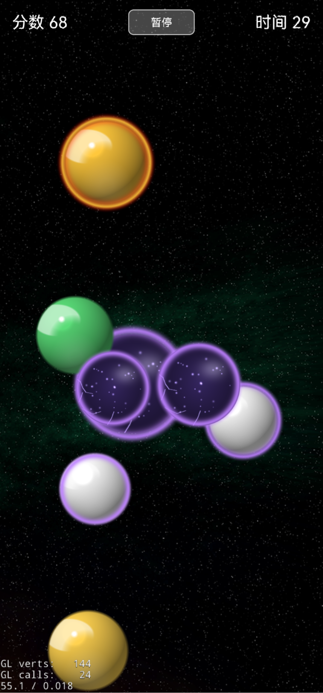
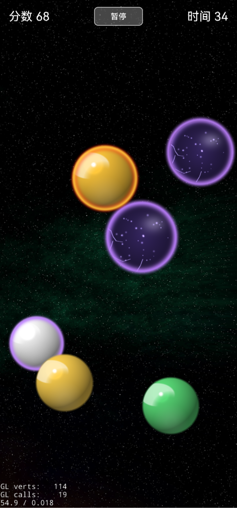
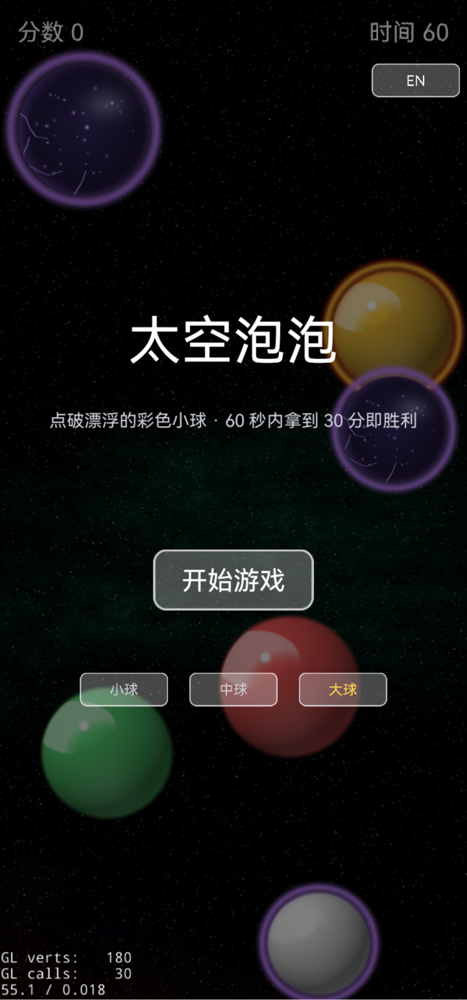

# Space Bubble · 太空泡泡

<p align="center">
  
</p>

**A cozy 60-second bubble-popping arcade game for Android.**
Free · No ads · No tracking · Plays fully offline

[Download the APK](#-download--install) · [中文说明](#-中文说明)

---

## 🫧 English

### What is this?

Pop the floating bubbles in space! Each round lasts **60 seconds** — pop enough bubbles to hit the target score before time runs out. Small bubbles are worth more, chain your pops quickly for **combo bonuses**, and watch for rare **golden balls** worth big points.

There's also a secret: about **1 in 25 new bubbles is a hidden egg ball** (deep purple, with a starry cracked shell). Press and hold it for **3 seconds** to charge it up, and it bursts for a fat **+20 bonus**. Let go early and nothing happens — it just floats back, zero penalty.

### Features

- ☝️ One-finger play — tap to pop, anyone can pick it up in 5 seconds
- ⏱️ Quick 60-second rounds, perfect for a coffee break
- 🔗 Combo scoring + rare golden balls for big points
- 🥚 Hidden egg balls: hold 3 seconds to charge, +20 points
- 📏 Three bubble sizes to choose from on the start screen (Small / Medium / Large)
- 📳 Juicy haptic feedback and paint-splat pop effects
- 🌐 Chinese & English UI — follows your system language, switchable anytime in-game
- 🎨 Optional: use your own images as bubble faces (images stay on your device only)
- 💾 Best score saved locally, ★ New Record celebration

### Requirements

| | |
|---|---|
| OS | Android 4.1+ (64-bit ARM phones — all mainstream phones since ~2016) |
| Size | ≈ 10 MB download |
| Network | Not needed. Ever. |

> ❌ Not for x86 emulators or 32-bit-only devices.

### 📥 Download & Install

**Download: [SpaceBubble-1.1.apk](SpaceBubble-1.1.apk)** — signed release build (v1.1)

This game is **not on Google Play or any app store** — the APK is distributed directly through this GitHub repo. That means a manual one-time install:

1. **Download** the APK on your phone: tap the link above, then the *Download* / *View raw* button.
2. **Tap the downloaded file**. Android will ask you to allow installs from your browser or file manager → tap **Allow** (or *Settings → Install unknown apps*).
3. **Google Play Protect may show a warning** ("unknown app" / "unsafe app blocked"). This is normal for any APK outside the Play Store — tap **More details → Install anyway**. The APK is signed with a private key held only by the developer; the SHA-256 cert fingerprint is listed below.
4. Open the game and play. No account, no permissions to grant, no setup.

**Cert fingerprint (SHA-256) of the signing certificate:**
```
46:6C:BE:30:5E:E1:9B:FD:21:F6:07:79:CD:E6:83:3F:7D:3D:B7:99:2C:A5:1B:F7:8F:1F:84:1D:5D:3C:3C:9D
```

### 🔄 Updates

GitHub can't auto-update sideloaded apps. When a new version comes out, we'll put the new APK in this repo — just download and install it over the old one. Your best score is preserved (updates keep the same signing key and app data).

### 🔒 Privacy

- Plays **100% offline**. No ads, no analytics, no tracking, no account, no network connection of any kind.
- The APK requests a few legacy permissions (network state, external storage) inherited from the open-source Cocos2d-x engine template. The game itself never uses them to connect anywhere or collect anything.
- The `VIBRATE` permission is used for haptic feedback when popping bubbles.
- The optional "custom bubble face" feature only reads images you place in the game's own private folder on your device. They never leave your phone and are removed when you uninstall.

### 🎨 Credits & Tech

- Engine: [Cocos2d-Lua Community 4.0.5](https://github.com/communitycocos/cocos2d-lua-community) (Cocos2d-x)
- Paint splat effects: [Kenney Splat Pack](https://kenney.nl) (CC0)
- Space backdrop: OpenGameArt (CC0, by beren77)
- Source code: [agoodcoolman/cocos-bubble-pop](https://github.com/agoodcoolman/cocos-bubble-pop) (private at the moment)

### License

Free to play and share — the APK may be redistributed as-is. Game © 2026 agoodcoolman.

---

## 🫧 中文说明

### 这是什么？

点破太空中漂浮的泡泡！每局 **60 秒**，在时间走完前拿到目标分数即胜利。小球分高，快速连点有**连击加成**，偶尔出现的**金球**一点就是大分。

还藏了个小彩蛋：大约每 25 个新球里有 1 个是**彩蛋球**（深紫色、带星点裂纹）。**按住它 3 秒**充能，充满自动引爆 **+20 分**；中途松手毫无惩罚，球继续漂，随时可以再来。

### 特色

- ☝️ 单指游玩，5 秒上手
- ⏱️ 一局 60 秒，碎片时间来一把
- 🔗 连击计分 + 稀有金球大分
- 🥚 彩蛋球：按住 3 秒引爆，+20 分
- 📏 开始界面可选 小球 / 中球 / 大球
- 📳 点破带震动反馈 + 泼溅动画
- 🌐 中英双语界面，跟随系统语言，游戏内一键切换
- 🎨 可选玩法：把自己的图片设为球面（图片只存在你手机里）
- 💾 本地保存历史最高分，破纪录有 ★ 新纪录庆祝

### 设备要求

- Android 4.1 及以上（64 位 ARM 手机，2016 年以来的主流机型都可以）
- 安装包约 10 MB
- **完全离线**，不需要任何网络

### 📥 下载与安装

**下载：[SpaceBubble-1.1.apk](SpaceBubble-1.1.apk)**（v1.1 签名正式包）

本游戏**不上架任何应用市场**，APK 直接发布在本 GitHub 仓库，需要手动安装一次：

1. 在手机上点上面的链接，点 **Download / View raw** 下载 APK；
2. 点开下载好的文件，系统会提示允许浏览器/文件管理器安装应用 → 点**允许**；
3. 如果弹出 **Play Protect（播放保护）警告**，这是安装商店外 APK 的正常提示，点**更多详情 → 仍然安装**即可；APK 由开发者私有证书签名，指纹见上方英文部分；
4. 装完打开即玩，无需注册、无需授权、无需联网。

### 🔄 更新

GitHub 无法自动更新侧载应用。新版本发布后，直接在这里下载新 APK 覆盖安装即可，最高分等本地数据会保留（签名证书不变）。

### 🔒 隐私

- 游戏 **100% 离线**：无广告、无统计 SDK、无追踪、无账号、无任何网络请求。
- 安装包带有引擎模板（开源 Cocos2d-x）遗留的几个旧权限声明（网络状态、外部存储），游戏本体从未用它们联网或收集数据。
- `VIBRATE`（震动）权限用于点破泡泡时的触感反馈。
- 「自定义球面」功能只读取你自己放进游戏私有目录的图片，图片不会离开手机，卸载即清除。

### 许可

免费游玩、自由分享，APK 可原样转发。游戏 © 2026 agoodcoolman。

---

<p align="center">
  
  &nbsp;
  
</p>
